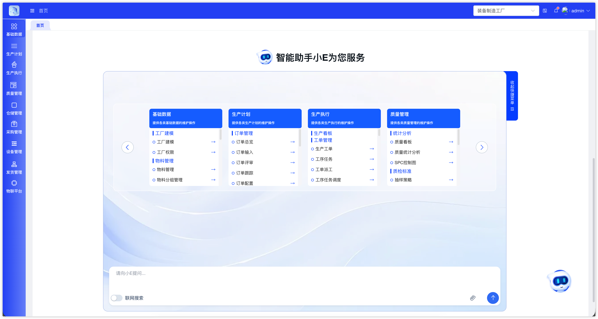

# MOM-Cloud

MOM-Cloud 是面向现代制造企业的开源 MOM/MES 后端平台，提供从订单接收、计划排程、生产执行到质量追溯的全链路数字化能力。

## 界面预览

| 登录业务 | 系统首页 |
|---|---|
|  |  |
| 用户登录与身份入口 | 系统首页与业务导航总览 |

## 模块说明

| 模块             | 说明 |
|----------------|------|
| **mom-boot**   | 单体启动器 |
| **mom-common** | 公共模块 |
| **mom-mdm**    | 主数据管理 |
| **mom-mes**    | 制造执行系统 |
| **mom-wms**    | 仓库管理 |
| **mom-qms**    | 质量管理 |
| **mom-tpm**    | 设备管理 |
| **mom-plan**   | 计划模块 |
| **mom-pms**    | 采购管理 |
| **mom-iot**    | 物联网平台 |

## 相关项目

除 `Mom-Cloud` 外，完整产品体系还包括：

- **Mom-UI（Web 端）**：覆盖 MES/WMS/QMS/MDM/计划等业务模块的前端系统。
- **PLC 上位机端**：设备接入、数据采集、控制联动与工业现场通信。
- **产线工作台**：面向工位操作的生产执行终端（报工、过站、追溯、异常处理）。
- **PDA / 移动端**：支持扫码、盘点、收发料、质检录入等移动作业场景。

## 技术栈

- **语言与运行时**：Java 17+
- **框架体系**：Spring Boot、Spring Cloud
- **构建工具**：Maven
- **服务治理**：Nacos
- **服务通信**：OpenFeign

## 源码与配置获取说明

因项目隐私要求，部分子项目源码、部署配置与行业化扩展能力暂不在公开仓库完整提供。

如需获取 UI、PLC 上位机、产线工作台、PDA 等项目资料，请联系：

- **邮箱**：[kitelcdp@163.com](mailto:kitelcdp@163.com)

邮箱沟通即可，无需添加好友或提供与合作无关的个人信息。

如有行业化扩展、功能增强或部署适配需求，可在邮件中统一说明，我们将根据需求提供定制化支持与对应资料。
