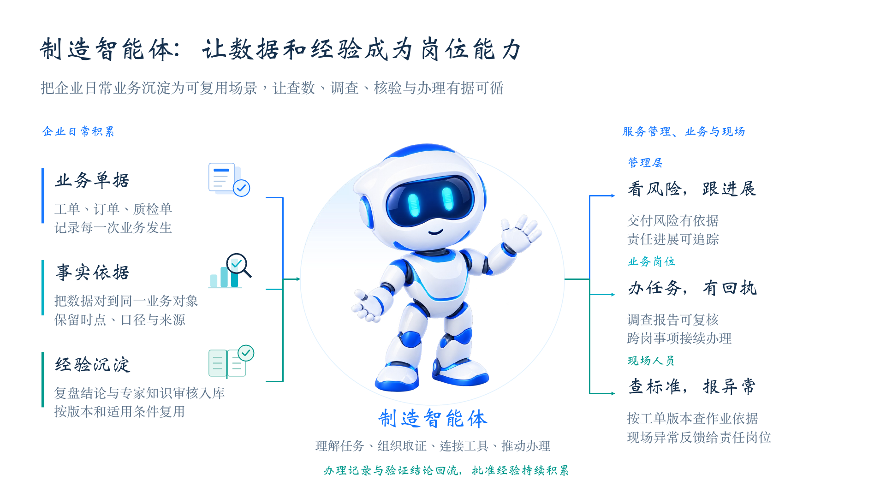
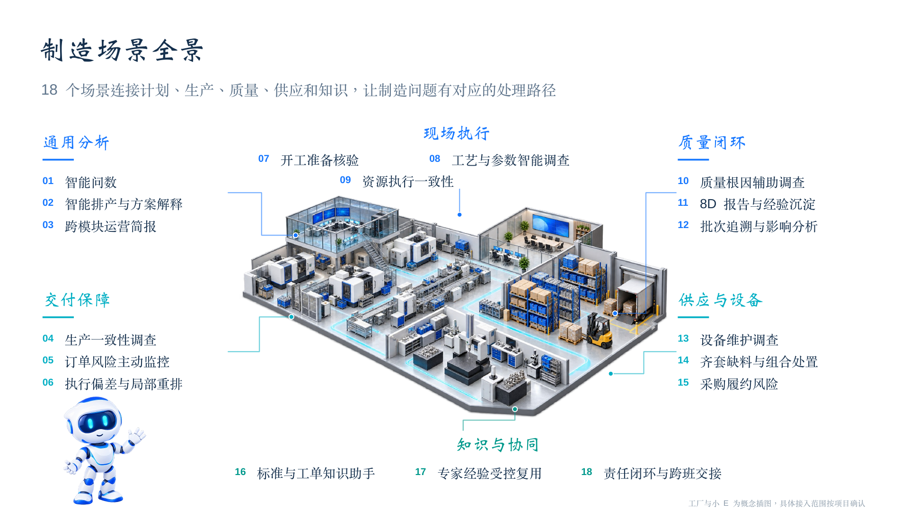
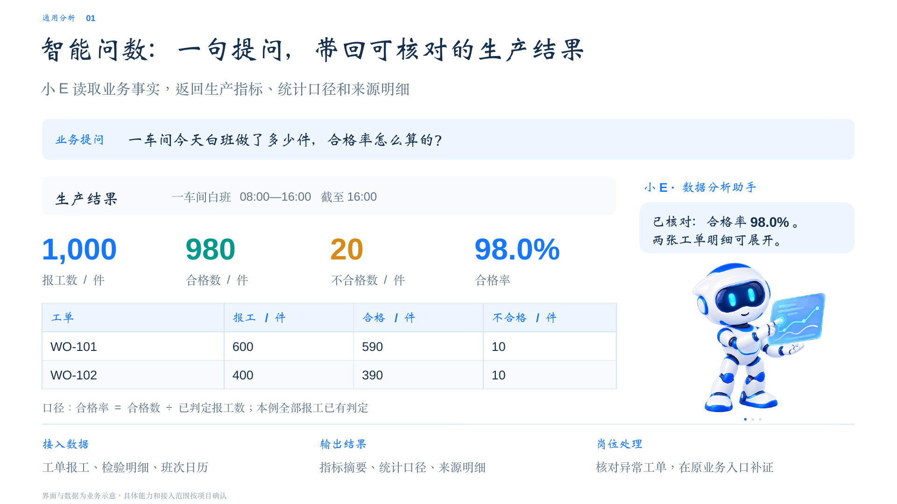
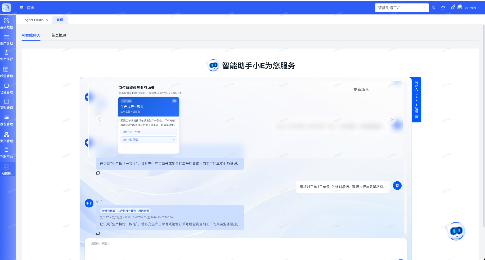

# MOM-Cloud

[](#技术栈)
[](./LICENSE)

MOM-Cloud 是面向制造企业的 MOM/MES 业务后端，覆盖主数据、计划排程、生产执行、仓储、质量、设备和物联网等业务领域。本仓库提供业务模块的公开源码，与 Mom-Base 基础服务、Mom-UI 前端配套使用。

## 仓库地址与项目分工

| 项目 | 仓库 | 职责 |
|---|---|---|
| **Mom-Cloud（本仓库）** | [GitCode / MOM-Cloud](https://gitcode.com/CodeOrg/MOM-Cloud) | 制造运营业务后端与业务接口 |
| **Mom-Base** | [GitCode / MOM-Base](https://gitcode.com/CodeOrg/MOM-Base) | 认证、网关、系统管理、流程及可视化基础服务 |
| **Mom-UI** | [GitCode / Mom-UI](https://gitcode.com/CodeOrg/Mom-UI) | 管理端及各业务模块的 Web 前端 |

三者配套使用。Base 的 `mom-common` 基础库源码不在公开范围内，通过公网 Maven 获取；本仓库的 `mom-common` 是业务公共模块，两者职责不同。

## 制造智能体场景

MOM Agent 面向制造运营岗位，将 MOM 业务数据、批准知识和专业工具组织到具体任务中，帮助管理层、业务岗位和现场人员围绕同一业务对象开展查询、调查、核验与协同办理。

智能体以工单、订单、质检单、设备和物料等业务事实为依据，保留数据时点、统计口径和来源。模型负责理解问题与解释结果，业务岗位在原系统中审核和执行，办理记录与验证结论可以继续沉淀为企业经验。

> 以下内容展示制造智能体的场景蓝图和产品方向。具体功能、数据接入范围及交付方式以实际项目确认为准。

### 场景与商业介绍






### 场景全景

当前场景蓝图覆盖计划、生产、质量、供应、设备和知识协同，共分为 6 类 18 个场景：

| 场景领域 | 智能体场景 |
|---|---|
| **通用分析** | 01 智能问数<br>02 智能排产与方案解释<br>03 跨模块运营简报 |
| **交付保障** | 04 生产一致性调查<br>05 订单风险主动监控<br>06 执行偏差与局部重排 |
| **现场执行** | 07 开工准备核验<br>08 工艺与参数智能调查<br>09 资源执行一致性 |
| **质量闭环** | 10 质量根因辅助调查<br>11 8D 报告与经验沉淀<br>12 批次追溯与影响分析 |
| **供应与设备** | 13 设备维护调查<br>14 齐套缺料与组合处置<br>15 采购履约风险 |
| **知识与协同** | 16 标准与工单知识助手<br>17 专家经验受控复用<br>18 责任闭环与跨班交接 |

这些场景围绕制造现场的高频任务展开。例如：查询生产指标时同步返回统计口径与来源明细；开工前核验物料、设备、工装、人员资质和作业文件；质量异常发生后关联检验、加工履历和批次流向；缺料或设备异常影响交付时，持续记录责任、办理结果与复核结论。

### 典型场景示例

#### 智能问数



#### 开工准备核验


#### 质量根因辅助调查


### 产品界面示意

| 智能体场景工作台 | 业务页面对话助手 |
|---|---|
|  |  |
| 从岗位场景进入任务，并补充工单等业务对象 | 在业务页面中随时提问，围绕当前任务继续调查和办理 |

### 平台协同方式

- **MOM 业务事实**：提供工单、订单、质量、资源、库存等可追溯数据。
- **专业工具**：由 APS 等求解器计算候选方案，智能体负责组织依据并解释影响。
- **批准知识**：按工单冻结版本引用标准原件和经过审核的专家经验。
- **岗位审核**：模型输出作为调查和决策辅助，最终由业务岗位审核，并通过原业务入口执行和留痕。

## MOM 系统界面预览

| 登录业务 | 系统首页 |
|---|---|
|  |  |
| 用户登录与身份入口 | 系统首页与业务导航总览 |

## 模块说明

| 模块             | 说明 |
|----------------|------|
| **mom-boot**   | 单体启动入口；当前根 POM 未将其列入默认聚合构建 |
| **mom-common** | 业务公共 API 与业务服务，不是 Base 的闭源基础库 |
| **mom-mdm**    | 主数据管理 |
| **mom-mes**    | 制造执行系统 |
| **mom-wms**    | 仓库管理 |
| **mom-qms**    | 质量管理 |
| **mom-tpm**    | 设备管理 |
| **mom-plan**   | 计划模块 |
| **mom-pms**    | 采购管理 |
| **mom-iot**    | 物联网平台 |

## 相关项目

完整产品体系还包括：

- **[Mom-Base](https://gitcode.com/CodeOrg/MOM-Base)**：提供认证、网关、系统管理等配套基础服务。
- **[Mom-UI（Web 端）](https://gitcode.com/CodeOrg/Mom-UI)**：覆盖 MES/WMS/QMS/MDM/计划等业务模块的前端系统；源码公开进度和前端依赖说明见该仓库 README。
- **PLC 上位机端**：设备接入、数据采集、控制联动与工业现场通信。
- **产线工作台**：面向工位操作的生产执行终端（报工、过站、追溯、异常处理）。
- **PDA / 移动端**：支持扫码、盘点、收发料、质检录入等移动作业场景。

## 技术栈

- **语言与运行时**：Java 17+
- **框架体系**：Spring Boot、Spring Cloud
- **构建工具**：Maven
- **服务治理**：Nacos
- **服务通信**：OpenFeign

## 获取与构建

### 1. 获取配套仓库

以下示例将后端与基础服务放在同级目录，便于使用 Base 提供的公共 Maven 配置：

```sh
git clone https://gitcode.com/CodeOrg/MOM-Base.git Mom-Base
git clone https://gitcode.com/CodeOrg/MOM-Cloud.git Mom-Cloud
cd Mom-Cloud
```

### 2. 准备依赖

- 准备 JDK 17 或以上版本、Maven；具体依赖版本以 POM 为准。
- 当前父 POM 为 `com.kitex:mom:2.0.0-SNAPSHOT`。父 POM、BOM、Base 基础库及其完整父链需要在公网 Maven 仓库提供对应版本。
- 使用 `../Mom-Base/settings.xml` 指定依赖仓库。该模板不包含账号密码；仓库地址见 [Mom-Base](https://gitcode.com/CodeOrg/MOM-Base)。Maven 不会自动读取项目根目录的 settings.xml，命令中需要显式指定。
- 克隆 Base 服务源码不能替代闭源基础制品。遇到认证失败或制品不存在时，需要先确认仓库读取权限和版本发布情况。

### 3. 构建业务模块

```sh
mvn -s ../Mom-Base/settings.xml -Dmaven.test.skip=true clean package
```

该命令按根 POM 的 `<modules>` 构建公开业务模块。`mom-boot` 的单体运行方式需要单独核对依赖和配置，不能直接套用微服务构建结果。

## 运行准备与启动入口

运行前先准备 Nacos、数据库、Redis，以及所需的 Base 认证、管理和网关服务。数据库表结构、必要字典及初始配置须与源码版本匹配；本仓库不包含完整生产数据库或生产配置。

各业务服务通过 Nacos 获取环境配置。公共连接变量包括 `MOM_NACOS_SERVER_ADDR`、`MOM_NACOS_NAMESPACE`、`MOM_NACOS_GROUP`、`MOM_NACOS_USERNAME`、`MOM_NACOS_PASSWORD` 和 `MOM_CONFIG_PROFILE`，可参考 Base 的 `.env.example`。应用自身的数据库、Redis、存储等配置需要在对应环境另行准备。占位地址和脱敏值不能直接用于启动。

| 业务服务 | Java 启动入口 |
|---|---|
| 主数据 | `com.kitex.mom.mdm.MomMdmApplication` |
| 制造执行 | `com.kitex.mom.mes.MomMesApplication` |
| 计划 | `com.kitex.mom.plan.MomPlanApplication` |
| 采购 | `com.kitex.mom.pms.MomPmsApplication` |
| 仓储 | `com.kitex.mom.wms.MomWmsApplication` |
| 设备 | `com.kitex.mom.tpm.MomTpmApplication` |
| 质量 | `com.kitex.mom.qms.MomQmsApplication` |
| 业务公共服务 | `com.kitex.mom.common.MomCommonApplication` |
| 物联网系统服务 | `com.kitex.mom.iot.MomIotSystemApplication` |

可按需运行对应入口，或使用构建后服务模块 `target` 中的可执行 JAR。启动后检查服务注册、网关路由及接口，再连接 Mom-UI；服务端口和访问路径以实际环境配置为准。

## 公开范围与使用前提

- 本仓库面向项目展示、技术交流与业务开发，公开内容以当前版本实际文件为准。
- Base 基础包通过 Maven 提供；部分行业扩展、设备端和商业交付内容不包含在本仓库。
- 生产账号、部署地址、业务数据和完整生产配置不随源码提供。
- 公开依赖、基础服务、数据库基线和环境配置准备完成后，才能验证完整业务运行。源码构建与整套系统启动需分别验收。
- 制造智能体部分为场景蓝图和产品方向，具体交付范围以对应版本及项目确认为准。

## 源码与配置获取说明

因项目隐私要求，部分子项目源码、部署配置与行业化扩展能力暂不在公开仓库完整提供。

Cloud、Base、UI 的公开入口见上方仓库表。关于未公开资料、PLC 上位机、产线工作台、PDA、基础制品获取或部署适配，请联系：

- **邮箱**：[kitelcdp@163.com](mailto:kitelcdp@163.com)

邮箱沟通即可，无需添加好友或提供与合作无关的个人信息。

如有行业化扩展、功能增强或部署适配需求，可在邮件中统一说明，我们将根据需求提供定制化支持与对应资料。
