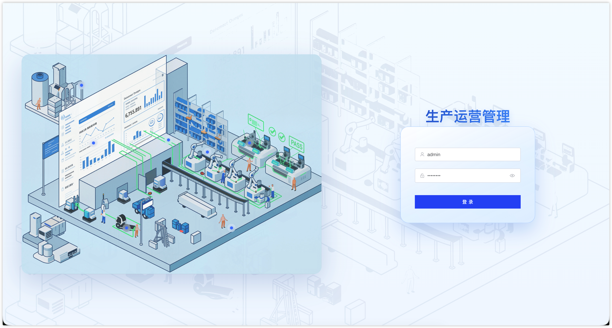
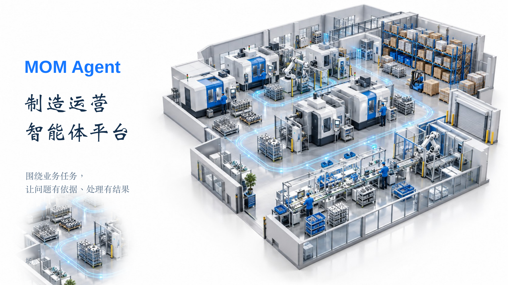
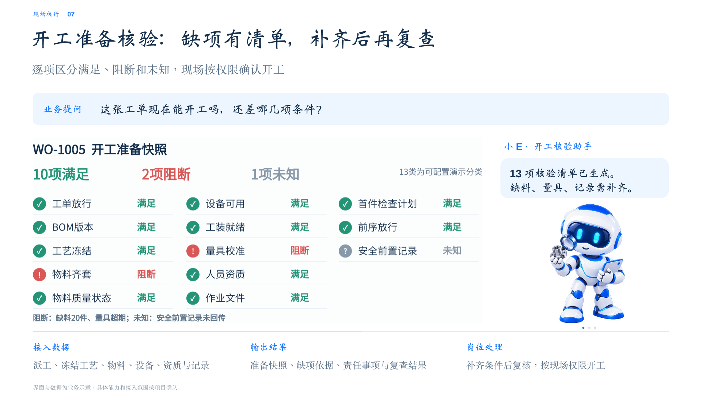
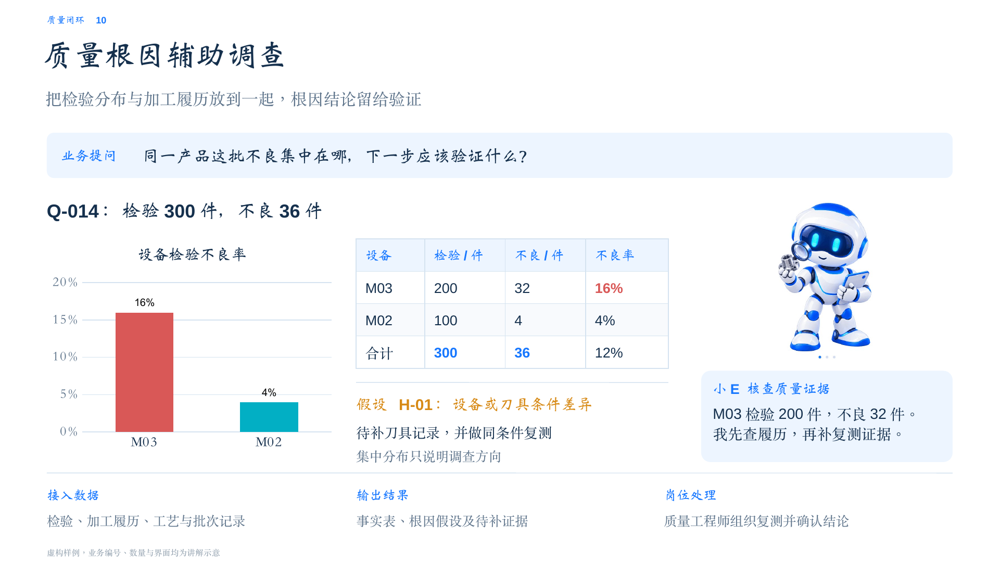
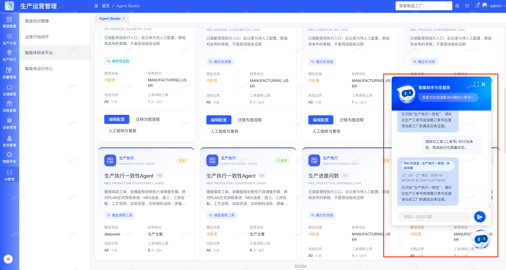

# MOM-Cloud · 制造运营业务开发平台

[](#技术栈)
[](./LICENSE)

**围绕主数据、计划、生产、仓储、质量、设备与物联网，构建可持续扩展的制造运营业务。**

MOM-Cloud 面向制造企业信息化团队、实施团队与业务开发者，提供 MOM / MES 业务后端的公开源码和二次开发参考，与 Mom-Base 基础服务、Mom-UI 前端配套使用。

[查看业务与界面](#业务场景与界面预览) · [申请体验资料](#申请体验资料) · [获取配套源码](#仓库与模块) · [了解制造智能体方向](#制造智能体路线图)

> 当前公开业务源码；数据库建表、初始化、升级及验证 SQL 不随仓库提供，体验资料需按版本另行沟通。完整启动还需要基础依赖、数据库基线与环境配置，不能将源码克隆等同于整套系统已可运行。

## 适合谁

- **制造企业信息化团队**：评估生产、仓储、质量和设备等业务模块，梳理系统建设与集成边界。
- **实施与集成团队**：研究跨模块业务组织、接口和服务协作，评估行业适配与项目二次开发。
- **Java / 前端开发者**：结合业务后端与配套 UI，学习制造业务建模、接口设计与模块扩展。

## 业务场景与界面预览

可以从一个具体业务对象入手阅读代码，再扩展到相关模块。建议优先选择与你的项目最接近的一条业务流程评估：

| 业务方向 | 建议关注的业务内容 | 对应模块 |
|---|---|---|
| 主数据与基础建模 | 物料、工艺、资源等基础业务对象与关联关系 | `mom-mdm` |
| 计划与生产执行 | 计划协同、工单派工、现场执行与报工 | `mom-plan`、`mom-mes` |
| 仓储与物料流转 | 入出库、领退料、库存与业务回执 | `mom-wms` |
| 质量与异常处理 | 检验任务、质量判定、不合格与返工相关业务 | `mom-qms` |
| 设备与现场资源 | 设备点检、维护、维修及备件管理 | `mom-tpm` |
| 采购与设备接入 | 采购相关业务、设备接入与工业数据协同 | `mom-pms`、`mom-iot` |

这些方向对应当前仓库中的业务代码；具体可体验功能和联调范围，应以匹配版本、配套资料及实际验证结果为准。

### 系统页面预览


<details>
<summary>查看登录页面</summary>



</details>

现有截图展示登录与业务导航。工单、仓储、质检等具体流程的演示范围，可在申请体验资料时一并说明；下方智能体图片属于场景蓝图或界面示意。

## 公开内容与使用边界

| 内容 | 当前提供方式 |
|---|---|
| MOM 业务后端 | 本仓库公开源码，范围以实际文件为准 |
| 基础服务与 Web 前端 | 分别由 Mom-Base、Mom-UI 配套仓库提供 |
| Base 的 `mom-common` 基础库 | 源码不公开，通过公网 Maven 获取对应二进制依赖；需确认版本与读取权限 |
| 数据库与运行资料 | SQL 文件不随公开仓库发布；数据库基线、必要字典、示例配置与部署说明按版本沟通 |
| PLC 上位机、产线工作台、PDA / 移动端及行业扩展 | 不默认包含在这三个公开仓库中，可按具体需求沟通 |
| 制造智能体 | 本文展示场景蓝图和产品方向，具体交付范围以实际版本与项目确认为准 |

本仓库的 `mom-common` 是业务公共模块，与 Base 的基础库职责不同。生产账号、业务数据及实际部署配置不随源码提供。已公开文件的授权以各仓库 LICENSE 为准。

## 申请体验资料

**先选定一个业务场景，再确认与源码版本匹配的体验资料。资料申请与 Star 支持相互独立。**

如果你希望评估项目，可免费申请资料沟通，说明关注模块与试用用途。数据库基线、必要字典、演示数据、示例配置和启动说明的可提供范围，以及是否具备对应版本，均以实际确认为准；当前不承诺已有可直接下载的一键体验包。

- **联系邮箱**：[kitelcdp@163.com](mailto:kitelcdp@163.com)
- **建议邮件主题**：`MOM-Cloud 体验资料申请`

邮件中建议说明：

```text
关注模块：例如 MES / WMS / QMS
评估用途：学习研究 / 技术选型 / 项目二次开发
源码版本：分支、Tag 或提交号
希望验证的流程：例如工单报工与成品入库
```

我们会根据当前可提供的版本与资料沟通下一步。完整行业扩展、专门部署适配与项目实施支持，可在明确需求后另行沟通。

如果项目对你有帮助，欢迎在 [MOM-Cloud 主仓库](https://gitcode.com/CodeOrg/MOM-Cloud) 点 **Star** 收藏。试用反馈、业务建议和可复现的问题，同样是对项目的支持。

## 仓库与模块

| 项目 | 仓库 | 职责 |
|---|---|---|
| **Mom-Cloud（本仓库）** | [GitCode / MOM-Cloud](https://gitcode.com/CodeOrg/MOM-Cloud) | 制造运营业务后端与业务接口 |
| **Mom-Base** | [GitCode / MOM-Base](https://gitcode.com/CodeOrg/MOM-Base) | 认证、网关、系统管理、流程及可视化基础服务 |
| **Mom-UI** | [GitCode / Mom-UI](https://gitcode.com/CodeOrg/Mom-UI) | 管理端与各业务模块的 Web 前端 |

三个仓库配套使用。完整启动需同时满足所用版本的基础制品、前端依赖与运行配置要求；单独克隆其中一个仓库不能替代这些准备。

| 模块 | 内容 |
|---|---|
| `mom-mdm` | 主数据管理 |
| `mom-plan` | 计划相关业务 |
| `mom-mes` | 制造执行 |
| `mom-wms` | 仓储管理 |
| `mom-qms` | 质量管理 |
| `mom-tpm` | 设备管理 |
| `mom-pms` | 采购管理 |
| `mom-iot` | 物联网系统与协议相关服务 |
| `mom-common` | 业务公共 API 与公共服务 |
| `mom-boot` | 单体启动入口；当前未列入根 POM 的默认聚合构建 |

## 技术栈

- **语言与运行时**：Java 17+
- **框架体系**：Spring Boot、Spring Cloud
- **构建工具**：Maven
- **服务治理**：Nacos
- **服务通信**：OpenFeign

## 获取与构建

### 1. 获取配套仓库

以下示例将后端与基础服务放在同级目录，便于使用 Base 提供的公共 Maven 配置：

```sh
git clone https://gitcode.com/CodeOrg/MOM-Base.git Mom-Base
git clone https://gitcode.com/CodeOrg/MOM-Cloud.git Mom-Cloud
cd Mom-Cloud
```

### 2. 准备依赖

- 准备 JDK 17 或以上版本、Maven；具体依赖版本以 POM 为准。
- 当前父 POM 为 `com.kitex:mom:2.0.0-SNAPSHOT`。父 POM、BOM、Base 基础库及其完整父链需要在公网 Maven 仓库提供对应版本。
- 使用 `../Mom-Base/settings.xml` 指定依赖仓库。该模板不包含账号密码；仓库地址见 [Mom-Base](https://gitcode.com/CodeOrg/MOM-Base)。Maven 不会自动读取项目根目录的 settings.xml，命令中需要显式指定。
- 克隆 Base 服务源码不能替代闭源基础制品。遇到认证失败或制品不存在时，需要先确认仓库读取权限和版本发布情况。

### 3. 构建业务模块

```sh
mvn -s ../Mom-Base/settings.xml -Dmaven.test.skip=true clean package
```

该命令按根 POM 的 `<modules>` 构建公开业务模块。`mom-boot` 的单体运行方式需要单独核对依赖和配置，不能直接套用微服务构建结果。

## 运行准备与启动入口

运行前先准备 Nacos、数据库、Redis，以及所需的 Base 认证、管理和网关服务。数据库表结构、必要字典及初始配置须与源码版本匹配；本仓库不包含完整生产数据库或生产配置。

各业务服务通过 Nacos 获取环境配置。公共连接变量包括 `MOM_NACOS_SERVER_ADDR`、`MOM_NACOS_NAMESPACE`、`MOM_NACOS_GROUP`、`MOM_NACOS_USERNAME`、`MOM_NACOS_PASSWORD` 和 `MOM_CONFIG_PROFILE`，可参考 Base 的 `.env.example`。应用自身的数据库、Redis、存储等配置需要在对应环境另行准备。占位地址和脱敏值不能直接用于启动。

| 业务服务 | Java 启动入口 |
|---|---|
| 主数据 | `com.kitex.mom.mdm.MomMdmApplication` |
| 制造执行 | `com.kitex.mom.mes.MomMesApplication` |
| 计划 | `com.kitex.mom.plan.MomPlanApplication` |
| 采购 | `com.kitex.mom.pms.MomPmsApplication` |
| 仓储 | `com.kitex.mom.wms.MomWmsApplication` |
| 设备 | `com.kitex.mom.tpm.MomTpmApplication` |
| 质量 | `com.kitex.mom.qms.MomQmsApplication` |
| 业务公共服务 | `com.kitex.mom.common.MomCommonApplication` |
| 物联网系统服务 | `com.kitex.mom.iot.MomIotSystemApplication` |

可按需运行对应入口，或使用构建后服务模块 `target` 中的可执行 JAR。启动后检查服务注册、网关路由及接口，再连接 Mom-UI；服务端口和访问路径以实际环境配置为准。

## 制造智能体路线图

在制造业务基础上，MOM Agent 探索围绕岗位任务组织业务事实、批准知识与专业工具。以下保留场景规划及界面示意，供交流方向使用，不作为全部功能已在公开版本交付的承诺。

<details>
<summary>展开查看 6 类 18 个场景、典型任务与界面示意</summary>

MOM Agent 面向制造运营岗位，将 MOM 业务数据、批准知识和专业工具组织到具体任务中，帮助管理层、业务岗位和现场人员围绕同一业务对象开展查询、调查、核验与协同办理。

智能体以工单、订单、质检单、设备和物料等业务事实为依据，保留数据时点、统计口径和来源。模型负责理解问题与解释结果，业务岗位在原系统中审核和执行，办理记录与验证结论可以继续沉淀为企业经验。

> 以下内容展示制造智能体的场景蓝图和产品方向。具体功能、数据接入范围及交付方式以实际项目确认为准。

### 场景与商业介绍




### 场景全景

当前场景蓝图覆盖计划、生产、质量、供应、设备和知识协同，共分为 6 类 18 个场景：

| 场景领域 | 智能体场景 |
|---|---|
| **通用分析** | 01 智能问数<br>02 智能排产与方案解释<br>03 跨模块运营简报 |
| **交付保障** | 04 生产一致性调查<br>05 订单风险主动监控<br>06 执行偏差与局部重排 |
| **现场执行** | 07 开工准备核验<br>08 工艺与参数智能调查<br>09 资源执行一致性 |
| **质量闭环** | 10 质量根因辅助调查<br>11 8D 报告与经验沉淀<br>12 批次追溯与影响分析 |
| **供应与设备** | 13 设备维护调查<br>14 齐套缺料与组合处置<br>15 采购履约风险 |
| **知识与协同** | 16 标准与工单知识助手<br>17 专家经验受控复用<br>18 责任闭环与跨班交接 |

这些场景围绕制造现场的高频任务展开。例如：查询生产指标时同步返回统计口径与来源明细；开工前核验物料、设备、工装、人员资质和作业文件；质量异常发生后关联检验、加工履历和批次流向；缺料或设备异常影响交付时，持续记录责任、办理结果与复核结论。

### 典型场景示例

#### 智能问数


#### 开工准备核验



#### 质量根因辅助调查



### 产品界面示意

| 智能体场景工作台 | 业务页面对话助手 |
|---|---|
|  |  |
| 从岗位场景进入任务，并补充工单等业务对象 | 在业务页面中随时提问，围绕当前任务继续调查和办理 |

### 平台协同方式

- **MOM 业务事实**：提供工单、订单、质量、资源、库存等可追溯数据。
- **专业工具**：由 APS 等求解器计算候选方案，智能体负责组织依据并解释影响。
- **批准知识**：按工单冻结版本引用标准原件和经过审核的专家经验。
- **岗位审核**：模型输出作为调查和决策辅助，最终由业务岗位审核，并通过原业务入口执行和留痕。

</details>

## 交流与合作

欢迎围绕业务模块、系统集成、设备接入与行业化扩展交流。部署适配、功能增强、实施与定制支持，可通过 [项目邮箱](mailto:kitelcdp@163.com) 说明需求；我们会先确认当前能力、交付范围与资料版本。

公开问题与可复现缺陷可在仓库 Issues 中反馈。试用前建议先明确评估场景；源码构建、基础服务就绪与业务流程验收应分别验证。
